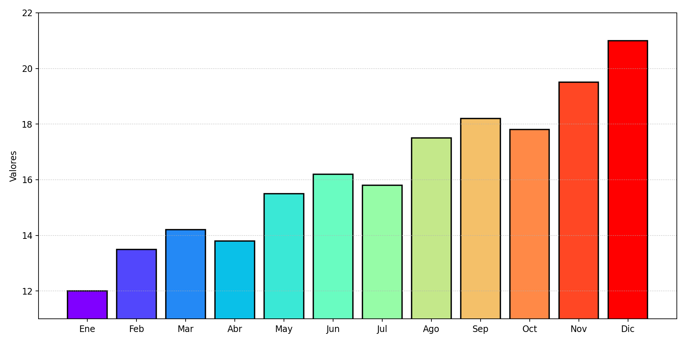
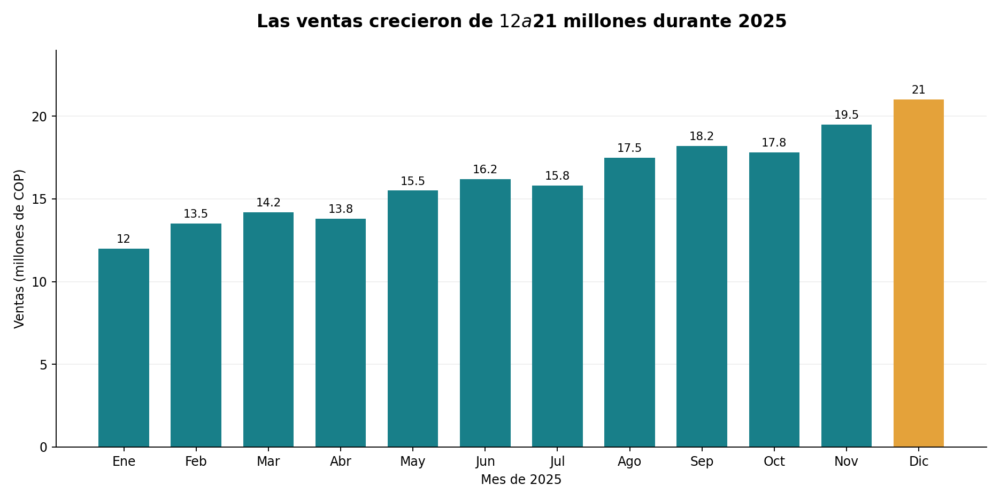

# Ciencia de Datos – Semana 12: Rediseña un gráfico

## Tema
Rediseño de un gráfico de ventas mensuales simuladas de una empresa de transporte durante 2025.

## Datos
Ventas mensuales en millones de pesos colombianos (COP): enero 12; febrero 13,5; marzo 14,2; abril 13,8; mayo 15,5; junio 16,2; julio 15,8; agosto 17,5; septiembre 18,2; octubre 17,8; noviembre 19,5; diciembre 21.

## Antes: gráfico incorrecto

El gráfico tiene una escala truncada (comienza en 11 en vez de cero), colores excesivos y un título ausente. Esto exagera visualmente las diferencias entre meses y dificulta su lectura.

## Después: gráfico mejorado

## ¿Qué mejoré y por qué?
En el gráfico original se utilizaron colores muy llamativos y una escala que no permitía interpretar correctamente los datos. Para mejorarlo, utilicé colores más adecuados, organicé la información y ajusté la escala para mostrar los valores reales. También agregué un título claro y las cantidades correspondientes a cada mes. Estos cambios permiten comprender mejor el comportamiento de las ventas y facilitan la comparación de los resultados.

## Cómo ejecutar
Instala `matplotlib` con `pip install matplotlib` y ejecuta `python redisenar_grafico.py` para generar ambas imágenes.

## Entrega
Subir estos tres archivos a la carpeta `12-week/` del fork del repositorio de la clase y realizar el commit con el mensaje `Entrega semana 12`.
